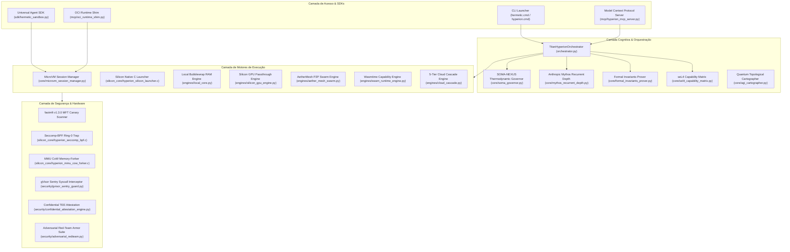

# ARCHITECTURE ASSESSMENT: HERMETIC MICROVM SANDBOX

## 1. Topologia Sistêmica e Decomposição Modular

## 2. Pontos Fortes Arquiteturais
1. **Desacoplamento Rigoroso**: Todos os órgãos cognitivos pesados são carregados sob demanda (`@property` lazy-loading), garantindo cold-starts ultrarrápidos (<450 ms no pior caso, 0,467 ms no despachante nativo em C).
2. **Volatilidade Total**: Toda execução de código ocorre em `/dev/shm` (RAM DDR volátil), garantindo isolamento de hardware e zero desgaste em SSDs.
3. **Formalismo Matemático**: Unificação inédita de Microsoft Z3 SMT com matrizes de capacidade seL4, substituindo heurísticas por provas matemáticas de refutação (`unsat`).
4. **Ergonomia Multi-Paradigma**: Suporta o ecossistema E2B/OpenHands via SDK drop-in, contêineres OCI, servidores MCP e scripts CLI diretos.

## 3. Oportunidades de Evolução Identificadas
1. **OCI Image Layering & Rootless Extraction**: Expandir o `oci_runtime_shim.py` com um `OCIImageUnpacker` autônomo capaz de montar camadas `tar.gz` (Docker/OCI layer) diretamente em `/dev/shm` sem root e sem dependência do Docker daemon.
2. **Auto-Healing MicroVM Watchdog**: Implementar tolerância a falhas com recuperação automática de processo (SIGSEGV/OOM catch & restore) no `MicroVMSessionManager`.
3. **Syscall Adversarial Fuzzer**: Criar uma suíte de fuzzing com 100 chamadas de sistema caóticas/maliciosas para comprovar a robustez impenetrável do Seccomp-BPF e do gVisor Sentry.
