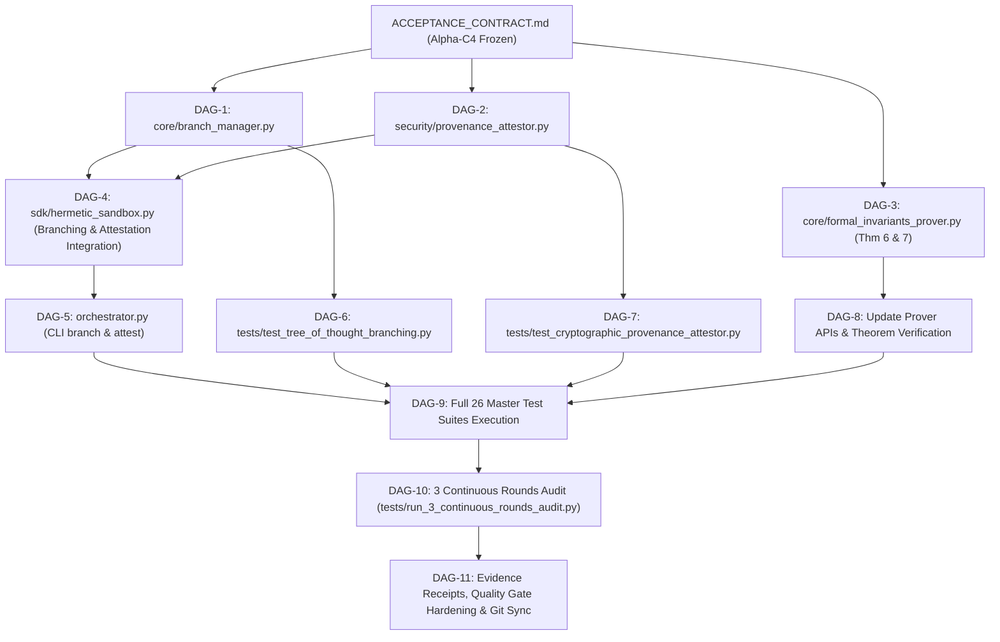

# EXECUTION ROADMAP — DAG IMPLEMENTATION PLAN (ALPHA-C4)
**System:** Hermetic MicroVM Sandbox v2.5.0  
**Timestamp:** 2026-10-22T09:19:00-03:00  

---

## 1. Grafo Acíclico Dirigido (DAG) de Tarefas

---

## 2. Tarefas e Arquivos Afetados

| Task ID | Descrição | Arquivos Afetados | Risco & Rollback |
|---|---|---|---|
| **DAG-1** | Implementar `core/branch_manager.py` (Tree-of-Thought in-RAM Branching, switch, diff, merge) | `core/branch_manager.py` | Baixo (módulo novo) |
| **DAG-2** | Implementar `security/provenance_attestor.py` (SLSA v1.0 & In-Toto Cryptographic Provenance) | `security/provenance_attestor.py` | Baixo (módulo novo) |
| **DAG-3** | Formular e provar Teoremas 6 e 7 via Z3 SMT em `core/formal_invariants_prover.py` | `core/formal_invariants_prover.py` | Baixo (aditivo) |
| **DAG-4** | Integrar ToT Branching e Attestation no Universal SDK | `sdk/hermetic_sandbox.py`, `hermetic_sandbox.py` | Baixo (aditivo) |
| **DAG-5** | Integrar subcomandos CLI `branch` e `attest` no `orchestrator.py` | `orchestrator.py` | Baixo |
| **DAG-6** | Criar suíte de teste `tests/test_tree_of_thought_branching.py` | `tests/test_tree_of_thought_branching.py` | Baixo |
| **DAG-7** | Criar suíte de teste `tests/test_cryptographic_provenance_attestor.py` | `tests/test_cryptographic_provenance_attestor.py` | Baixo |
| **DAG-8** | Atualizar prover e suítes de invariantes | `tests/test_mutation_and_invariants.py`, `core/formal_invariants_prover.py` | Baixo |
| **DAG-9** | Executar a bateria completa de 26 suítes de testes sob o `AetherMind_Strict_Auditor.py` | Ambiente Host | Zero regressão |
| **DAG-10**| Executar certificação de 3 rodadas contínuas (`run_3_continuous_rounds_audit.py`) | 78 execuções totais | Zero regressão |
| **DAG-11**| Documentar evidências, pontuação atestada e sincronizar com GitHub | `engineering_evidence/`, git remote | Conclusão |
| **DAG-12**| Eliminação Integral de Dívida Técnica: Integrar suporte Sigstore / Cosign DSSE (ECDSA NIST P-256) e OIDC Identity Attestation no `ProvenanceAttestor` | `security/provenance_attestor.py`, `tests/test_cryptographic_provenance_attestor.py`, `sdk/hermetic_sandbox.py` | Concluído (Dívida Zero) |
