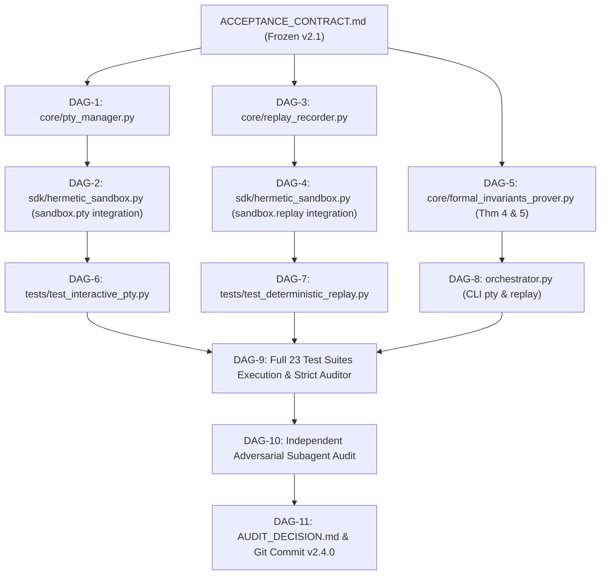

# EXECUTION ROADMAP — DAG IMPLEMENTATION PLAN (ROUND 3)
**System:** Hermetic MicroVM Sandbox v2.4.0  
**Timestamp:** 2026-10-21T17:37:00-03:00  

---

## 1. Grafo Acíclico Dirigido (DAG) de Tarefas

---

## 2. Tarefas e Arquivos Afetados

| Task ID | Descrição | Arquivos Afetados | Risco & Rollback |
|---|---|---|---|
| **DAG-1** | Implementar `core/pty_manager.py` (PTYSession, openpty bridge, non-blocking I/O) | `core/pty_manager.py` | Baixo (módulo novo) |
| **DAG-2** | Integrar PTY em `sdk/hermetic_sandbox.py` | `sdk/hermetic_sandbox.py`, `hermetic_sandbox.py` | Baixo (aditivo) |
| **DAG-3** | Implementar `core/replay_recorder.py` (Trajectory ledger, hashing, replay) | `core/replay_recorder.py` | Baixo (módulo novo) |
| **DAG-4** | Integrar Replay no `Sandbox` (`export_trace`, `replay_trace`) | `sdk/hermetic_sandbox.py` | Baixo (aditivo) |
| **DAG-5** | Adicionar Teoremas 4 e 5 em `core/formal_invariants_prover.py` | `core/formal_invariants_prover.py` | Baixo (aditivo) |
| **DAG-6** | Criar suíte de teste `tests/test_interactive_pty.py` | `tests/test_interactive_pty.py` | Baixo |
| **DAG-7** | Criar suíte de teste `tests/test_deterministic_replay.py` | `tests/test_deterministic_replay.py` | Baixo |
| **DAG-8** | Integrar CLI `pty` e `replay` no `orchestrator.py` | `orchestrator.py`, `pyproject.toml`, `.github/workflows/ci.yml` | Baixo |
| **DAG-9** | Executar as 23 suítes completas de testes sob o `AetherMind_Strict_Auditor.py` | Ambiente Host | Zero risco de regressão |
| **DAG-10**| Submeter a auditor independente adversarial (Agente 2) | Subagente cognitivo | Zero risco |
| **DAG-11**| Documentar evidências e sincronizar com GitHub | `engineering_evidence/`, git remote | Conclusão |
