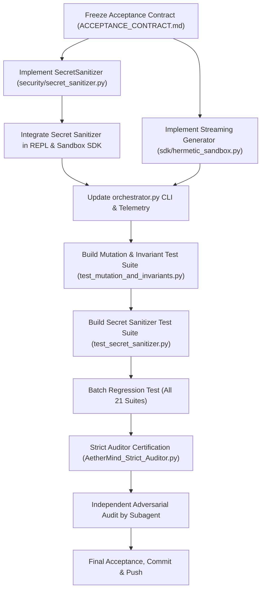

# EXECUTION ROADMAP & DAG — MASTER PROMPT V2
**System:** Hermetic MicroVM Sandbox v2.3.0  
**Timestamp:** 2026-10-21T16:51:00-03:00  

---

## 1. Directed Acyclic Graph (DAG) de Implementação

---

## 2. Caminho Crítico e Priorização
- **P0 (Crítico):** `security/secret_sanitizer.py` (Prevenção de vazamento de credenciais).
- **P1 (Funcional):** Streaming generator em `sdk/hermetic_sandbox.py`.
- **P2 (Adversarial):** Bateria de testes de mutação e invariantes.
- **P3 (Auditoria):** Execução independente pelo subagente e veredito do auditor.
