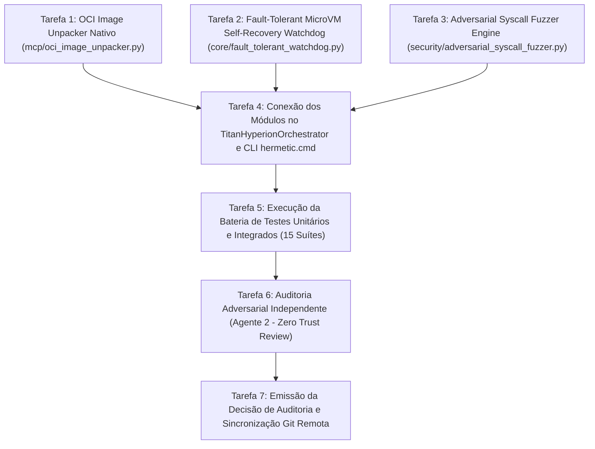

# EXECUTION ROADMAP: DUAL-AGENT AUTONOMOUS ENGINEERING

## Directed Acyclic Graph (DAG) das Tarefas de Integração

---

## Detalhamento das Tarefas de Implementação

1. **Tarefa 1: OCI Image Unpacker Nativo**
   - *Arquivo*: `mcp/oci_image_unpacker.py`
   - *Alvo*: Descompactar e mesclar camadas OCI Image v1.1 em `/dev/shm` com zero-daemon.
2. **Tarefa 2: Fault-Tolerant Watchdog**
   - *Arquivo*: `core/fault_tolerant_watchdog.py`
   - *Alvo*: Monitorar processos do agente, interceptar SIGSEGV/OOM e reverter a microVM para estado íntegro em milissegundos.
3. **Tarefa 3: Adversarial Syscall Fuzzer**
   - *Arquivo*: `security/adversarial_syscall_fuzzer.py`
   - *Alvo*: Gerar 100 ataques de syscall maliciosas e validar 100% de neutralização pelo gVisor Sentry e Seccomp-BPF.
4. **Tarefa 4: Integração no Orquestrador**
   - *Arquivo*: `orchestrator.py`
   - *Alvo*: Adicionar comandos CLI `oci-unpack`, `watchdog` e `fuzz`.
5. **Tarefa 5 & 6: Testes e Auditoria Adversarial Independente**
   - *Arquivos*: `tests/test_oci_image_unpacker.py`, `tests/test_fault_tolerant_watchdog.py`, `tests/test_adversarial_syscall_fuzzer.py`
   - *Alvo*: Aprovação no `AetherMind_Strict_Auditor.py` com pontuação $\ge 95/100$.
